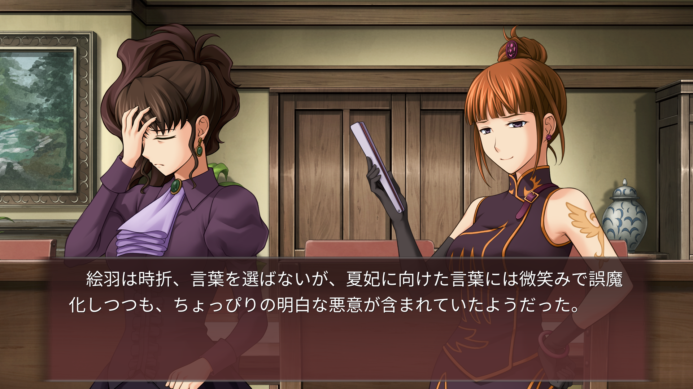
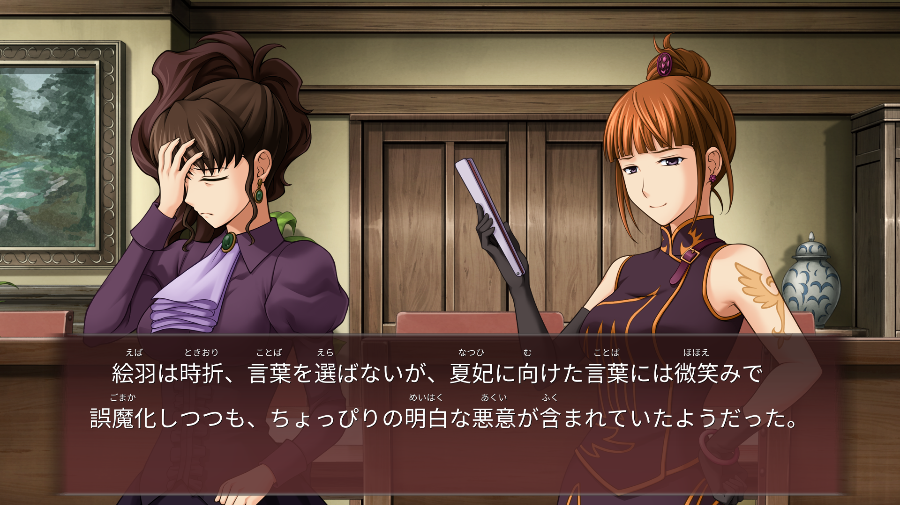

> [!NOTE]
> **이 포크에 대하여 — Yomigana**
>
> 현재 [`feat/japanese-ruby`](https://github.com/lyra95/ponscripter-fork/tree/feat/japanese-ruby)는 Windows 문제편(EP1–4)과 해답편(EP5–8)에 함께 사용하는 엔진입니다. `e06c6a2` 위에 기존 루비 변경과 렌더링 보정을 적용했으며, 이전 이름은 `feat/japanese-ruby-ep5-8`입니다. 원본 07th-Mod `ba457e4` 기반의 초기 문제편 브랜치는 [`backup/feat/japanese-ruby`](https://github.com/lyra95/ponscripter-fork/tree/backup/feat/japanese-ruby)에 보존했습니다. 답편의 `simul_*` 명령 지원 때문에 해당 기반을 유지했으며, 설치 실행 파일의 출처를 확인했다는 뜻은 아닙니다. 문제편에도 적용 후 사용자가 정상 동작을 보고했지만 전체 에피소드 호환성 검증은 아직입니다.
>
> 루비 표기는 `｜漢字《かんじ》`입니다. 독음 변환 도구는 기존 한글 대사·언어 전환·명령을 보존하는 것을 목표로 합니다.
>
> - **다른 컴퓨터로 이관:** [Steam 설치 기준 가이드 및 Windows 작업 인계](docs/YOMIGANA.md)
> - **Mac 바이너리(초기 문제편 소스 기반, 현재 Windows 브랜치와 별도):** [v0.1.0 초기 배포본](https://github.com/lyra95/ponscripter-fork/releases/tag/v0.1.0-macos-arm64) — EP1–4, arm64, macOS 26.0 이상.

## 루비 적용 전후

동일한 세이브의 같은 장면을 1920×1080으로 촬영했습니다. 이미지를 클릭하면 크게 볼 수 있습니다.

| 적용 전 | 루비 적용 후 |
| --- | --- |
|  |  |

# Ponscripter-fork (07th-mod)

## Introduction

Ponscripter was created as an NScripter-style visual novel game interpreter with an emphasis
on supporting games in Western languages.

This fork is intended to provide additional features to Ponscripter that make it more suitable for releasing
games on Steam. It, however, does not have qualms with breaking compatibility in minor ways. See the CHANGES file.

Other engines focussed on Western-language games include:

* [Ponscripter](http://web.archive.org/web/20180812034417/http://unclemion.com/onscripter/) &mdash; The project this is based on
* [Ren'Py](http://www.renpy.org/) &mdash; A modern visual novel engine with python scripting support.

## Additional Features in this fork

### Scaling Options

#### Default Scaling

> [!Warning]
> On versions v3.0.2 and below, the "Umineko Steam release scaling mode" was the default, which could cause problems if you didn't specify a scaling mode (See [#17 where Umineko Saku 2019 had graphical issues on v3.0.2 and below](https://github.com/07th-mod/ponscripter-fork/issues/17)). This has been fixed on v4.0.0 and above.

The default scaling option for our fork (as of v4.0.0) expects an input game resolution of 640x480 (eg. older nscripter games), and applies 2x mode (doubles everything). This is equivalent to explicitly setting the scaling mode with `;value2500,mode640@2x`.

#### Normal Scaling Options

This fork includes 2x mode, which can be used to support older Nscripter games at 2x resolution.

This feature has been added as an extra argument to `;mode` (e.g. `;mode960@2x`).

Widescreen support is also included, and can be enabled with `;modew720` or `;modew1080`.

For example, our modded Umineko scripts have `;value2500,modew540@2x@umineko` as the first line of the script to give a 1920x1080 output resolution (as the input height of 540 is doubled). As for the `@umineko` option, see below.

Please note that you MUST specify `mode` before specifying any other options like `@2x`, otherwise those commands will be ignored or cause problems.

#### Umineko Steam Scaling Mode

We've added an additional option for scaling to suit the Umineko Steam release. This changes the behavior of font scaling, and also the `getspsize` command - See d2b5d19 and e9c7e03.

In most cases you will never need to use this scaling mode, but if you wish to enable it, add `@umineko` after the `mode` command, for example the very first commented line of your script could be something like `;value2500,modew540@2x@umineko`

## Documentation

The below links contain general information about POnscripter (not specific to this fork of POnscripter):

* [Ponscripter Tutorial](https://07th-mod.github.io/ponscripter-fork) - Most likely you should start here
* [Ponscripter API Reference](https://07th-mod.github.io/ponscripter-fork/api/) - Mirror of Uncle Mion's Ponscripter API reference

## Compatibility

This incarnation of the engine has primarily been tested with the [Umineko](https://store.steampowered.com/app/406550/) script.

We strive to keep the engine able to compile and run correctly without the Steam runtime/api, but
the Steam platforms are our primary targets.

The following platforms are supported:

* Any modern Linux
* Windows 7/8/10
* OSX 10.9+

Any issues on these platforms should be reported.

## Bugs

Please report all bugs with this project on the [issues page](../../issues). Include your platform and, if possible, clear reproduction instructions.

## Acknowledgements

The original Ponscripter engine was maintained and, in great part, created by Mion.

Ponscripter is built primarily on Ogapee's work, without which there
would be nothing here.

The version of ONScripter taken as a base also includes notable
contributions from Chendo (original English support), insani
(further enhancements) and The Witch Hunt.

The following people (in alphabetical order) have contributed 
noteworthy patches and bug reports that have enhanced Ponscripter:

* Agilis
* chronotrig
* Daniel Oaks
* Euank
* Klashikari
* Mion of Sonozaki Futago-tachi
* Roine Gustafsson
* Roto
* Starchanchan

Apologies to anyone not mentioned &mdash; please let me know so I can set the
record straight!

## 07th-Mod fork

The 07th-Mod fork of this repo is brought to you with huge thanks to everyone mentioned above, but the latest changes are being maintained by the [07th-Mod](https://07th-mod.com) team. If you have any issues with this fork, please feel free to report them on the issues page or bother us on Discord about it.

## License

ONScripter is copyright © 2001-2007 Ogapee.  The Ponscripter fork is
copyright © 2006-2009 Haeleth.

Ponscripter is licensed under the GNU General Public License, version
2 or (at your option) any later version.  See COPYING for details.
